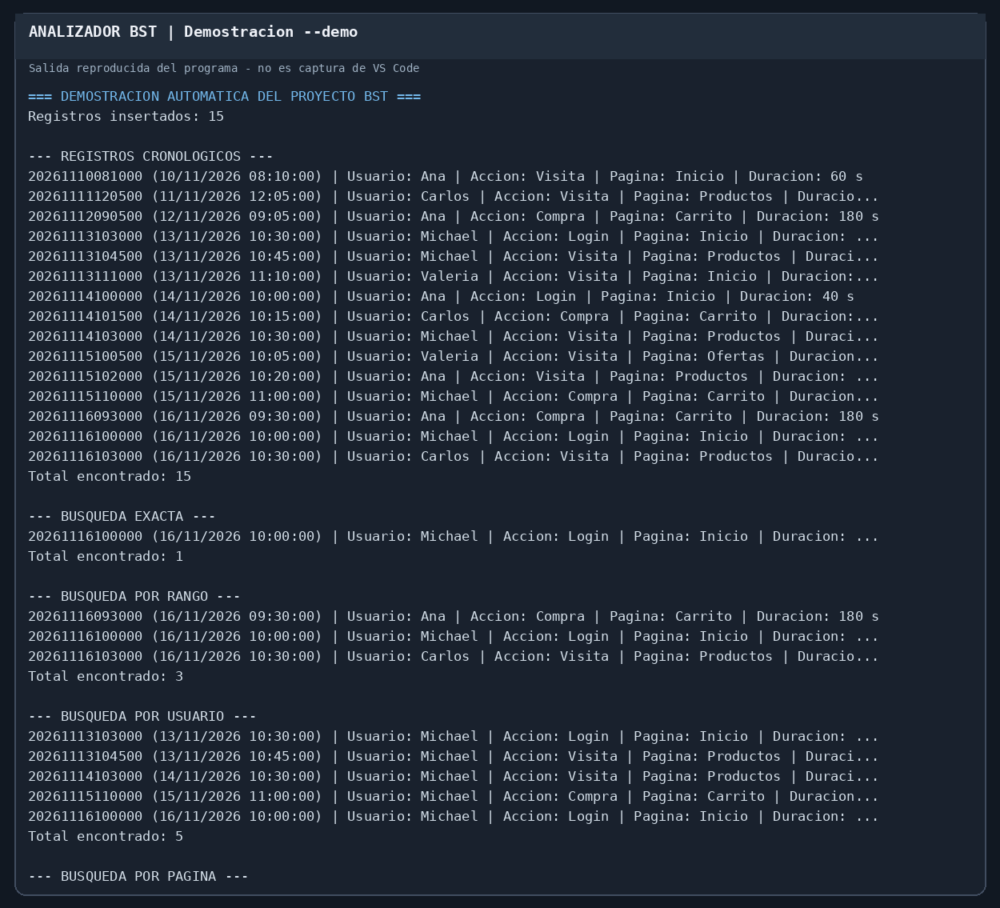
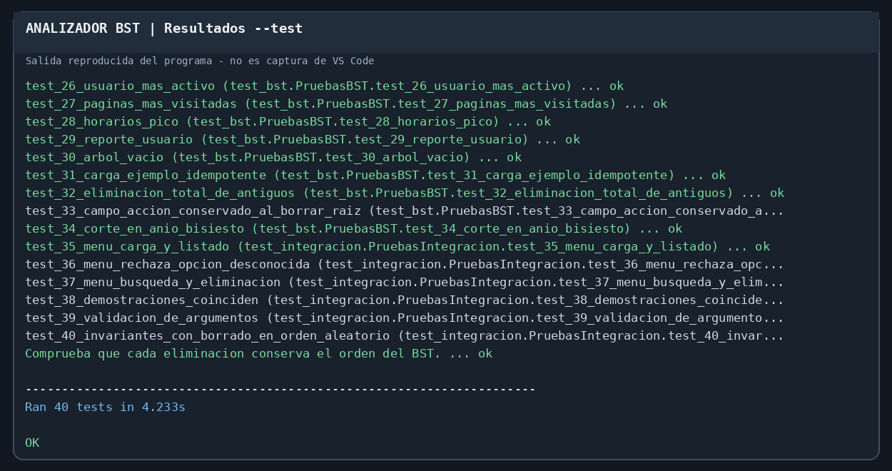

# Analizador de Registros con Árbol Binario de Búsqueda (BST)

**Trabajo final — Estructura de Datos y Algoritmos — Batería 5, Ejercicio 2**  
**Institución:** Tecsup  
**Lenguaje:** Python 3.12, sin librerías externas  
**Repositorio:** https://github.com/Mushuuxz/Analizador-Registros-BST

## 1. Integrantes

- **Michael Aldair Ataucusi Poma**
- **Segundo integrante:** *añadir el nombre real antes de entregar*

> **Importante sobre la entrega:** la consigna indica **un solo archivo `.py` ejecutable** para Canvas. Por eso este proyecto tiene **dos formas de ejecución**: una organizada por archivos para trabajar y explicar el código en Visual Studio Code, y `entrega_canvas.py` que ejecuta **todo de manera independiente**, con las clases, menú y bloque de pruebas en un solo archivo. No necesitas instalar nada más ni copiar carpetas para ejecutar `entrega_canvas.py`. En GitHub puedes mantener las dos versiones.

## 2. Introducción y problema

Un sitio de comercio electrónico genera registros cuando sus usuarios visitan páginas, inician sesión o compran productos. Si estos eventos se almacenan sin una organización, es difícil encontrar una visita de un momento determinado, analizar actividad por usuario o calcular las horas más concurridas.

La solución usa un **Árbol Binario de Búsqueda (BST) implementado desde cero**. Cada registro se ordena mediante una marca de tiempo numérica **única**, con formato `YYYYMMDDHHMMSS`. Un recorrido **inorden** entrega las visitas ordenadas de la más antigua a la más reciente. Los análisis por usuario, página, duración y hora se resuelven recorriendo el BST con recursividad.

### Objetivos

1. Registrar accesos web con fecha, usuario, acción, página y duración.
2. Insertar, buscar y eliminar registros mediante un BST propio.
3. Consultar intervalos de fechas, usuarios y páginas visitadas.
4. Obtener estadísticas recursivas y reportes de actividad.
5. Utilizar un menú de consola, validaciones de entrada y pruebas automáticas.

## 3. Estructura del proyecto en VS Code

```text
Analizador-Registros-BST/
│
├── main.py                       # Inicio del programa modular
├── entrega_canvas.py             # Código completo en UN solo .py para Canvas
├── README.md                     # Explicación y documentación
├── .gitignore                    # Ignora cachés y configuración local
│
├── src/                          # Código organizado por responsabilidad
│   ├── __init__.py
│   ├── nodo_registro.py           # Clase NodoRegistro
│   ├── arbol_bst.py              # Árbol, inserción, búsquedas y eliminación
│   ├── validaciones.py           # Comprobación de fechas, texto y duración
│   ├── estadisticas.py           # Recursión: conteos, promedio y usuario activo
│   ├── reportes.py               # Actividad, páginas populares y horarios pico
│   ├── datos_ejemplo.py          # Quince registros demostrativos
│   ├── vistas.py                 # Formato e impresión de resultados
│   └── interfaz.py               # Menú, opciones y demostración automática
│
├── tests/
│   ├── __init__.py
│   ├── test_bst.py               # 34 pruebas unitarias de operaciones
│   └── test_integracion.py       # 6 pruebas adicionales del programa
│
└── evidencias/
    ├── demostracion.txt          # Salida obtenida con --demo
    ├── pruebas.txt               # Resultado de las pruebas
    ├── captura_demo.png          # Imagen generada a partir de la salida
    └── captura_pruebas.png       # Imagen generada a partir de la salida
```

### ¿Cómo se conectan los archivos?

```text
main.py
  └── src/interfaz.py (menú principal)
       ├── src/arbol_bst.py (inserción, consulta, borrado)
       │    ├── src/nodo_registro.py
       │    ├── src/validaciones.py
       │    ├── src/estadisticas.py
       │    └── src/reportes.py
       ├── src/datos_ejemplo.py
       └── src/vistas.py (impresión de resultados)

tests/ ────────────> verifica operaciones y menú
entrega_canvas.py ─> ejecutable independiente con todas las piezas juntas
```

Los métodos de `EstadisticasBST` y `ReportesBST` están separados para que su lógica sea fácil de encontrar. `ArbolBST` hereda esos dos grupos de métodos, que operan sobre **el mismo árbol `self.raiz`**. No se utiliza ningún paquete de estructuras de datos: **el BST y sus nodos están implementados en Python desde cero**.

## 4. Modelo y funcionamiento del BST

### 4.1. Campos de cada nodo

| Campo | Propósito | Ejemplo |
|---|---|---|
| `fecha` | Identificador numérico único | `20261116100000` |
| `usuario` | Quién accedió al sitio | `Michael` |
| `accion` | Qué hizo | `Login` |
| `pagina` | Página visitada | `Inicio` |
| `duracion` | Tiempo en segundos | `45` |
| `izquierda` | Enlace a fechas menores | `None` o nodo |
| `derecha` | Enlace a fechas mayores | `None` o nodo |

### 4.2. Regla de organización

```text
                   20261116100000 (Michael)
                     /                 \
     20261116093000 (Ana)      20261116103000 (Carlos)

     Izquierda: fechas menores     Derecha: fechas mayores
```

Si el sistema inserta Michael, Carlos y después Ana, el recorrido inorden **izquierda → nodo → derecha** produce: Ana (09:30), Michael (10:00), Carlos (10:30). Se rechazan fechas duplicadas porque el BST usa esa clave para identificar registros de forma única.

### 4.3. Código representativo

Clase de nodo en `src/nodo_registro.py`:

```python
class NodoRegistro:
    def __init__(self, fecha, usuario, accion, pagina, duracion):
        self.fecha = fecha
        self.usuario = usuario
        self.accion = accion
        self.pagina = pagina
        self.duracion = duracion
        self.izquierda = None
        self.derecha = None
```

Inserción recursiva en `src/arbol_bst.py`:

```python
class ArbolBST(EstadisticasBST, ReportesBST):
    def __init__(self):
        self.raiz = None

    def _insertar(self, nodo, nuevo):
        if nodo is None:
            return nuevo
        if nuevo.fecha < nodo.fecha:
            nodo.izquierda = self._insertar(nodo.izquierda, nuevo)
        else:
            nodo.derecha = self._insertar(nodo.derecha, nuevo)
        return nodo
```

**Explicación:** se compara la fecha con la del nodo actual. Si es menor se baja por la izquierda y, si es mayor, por la derecha. La recursión termina al encontrar una posición vacía, donde se coloca el nodo nuevo. El método público `insertar` se encarga previamente de validar los campos y de rechazar duplicados. Los métodos del código incluyen comentarios y descripciones de su lógica.

## 5. Funciones implementadas

| Opción del menú | Funcionalidad | Archivo que contiene la lógica |
|---|---|---|
| 1 | Insertar un registro | `src/arbol_bst.py` |
| 2 | Buscar por fecha exacta | `src/arbol_bst.py` |
| 3 | Buscar entre dos fechas (incluidas) | `src/arbol_bst.py` |
| 4 | Buscar por usuario | `src/arbol_bst.py` |
| 5 | Buscar por página | `src/arbol_bst.py` |
| 6 | Eliminar registro por fecha | `src/arbol_bst.py` |
| 7 | Eliminar registros de más de X días | `src/arbol_bst.py` |
| 8 | Listar registros cronológicamente | `src/arbol_bst.py` |
| 9 | Total de accesos, conteos, duración media, usuario más activo | `src/estadisticas.py` |
| 10 | Reporte de actividad de un usuario | `src/reportes.py` |
| 11 | Páginas más visitadas | `src/reportes.py` |
| 12 | Horarios pico | `src/reportes.py` |
| 13 | Cargar 15 registros de ejemplo (opcional) | `src/datos_ejemplo.py` |
| 0 | Cerrar | `src/interfaz.py` |

**Eliminación:** por fecha se contemplan los nodos de cero, uno y dos hijos. Si hay dos hijos se reemplaza el contenido por el sucesor inorden, copiando *todos* los campos del registro. Para eliminar registros antiguos, el corte se calcula como **fecha de referencia menos X días** y se eliminan los registros **estrictamente anteriores** a ese instante.

**Búsquedas por usuario y página:** aunque el BST permite acelerar búsquedas por *fecha*, no está indexado por nombre o página; esas búsquedas deben recorrer todo el árbol. Se ignoran diferencias entre mayúsculas y minúsculas.

**Recursividad:** se utiliza en los recorridos y también para contar registros, agrupar accesos, sumar duraciones y analizar horas. Los diccionarios de Python se usan únicamente como acumuladores para estadísticas, no como sustitutos del BST.

## 6. Complejidad temporal (Big O)

Sea `n` el número de registros, `h` la altura del árbol, `k` los registros que devuelve un rango, `u` los usuarios únicos y `p` las páginas distintas.

| Operación | BST aproximadamente equilibrado | Peor caso sin equilibrar |
|---|---|---|
| Insertar | O(log n) | O(n) |
| Buscar fecha exacta | O(log n) | O(n) |
| Eliminar fecha | O(log n) | O(n) |
| Buscar rango de fechas | O(log n + k) | O(n) |
| Recorrido inorden | O(n) | O(n) |
| Buscar por usuario/página | O(n) | O(n) |
| Eliminar registros antiguos | O(n) en el peor caso | O(n) |
| Total registros y duración media | O(n) | O(n) |
| Contar accesos por usuario/página | O(n) promedio con diccionarios | O(n) promedio con diccionarios |
| Usuario más activo | O(n + u log u) | O(n + u log u) |
| Páginas más visitadas | O(n + p log p) | O(n + p log p) |
| Horarios pico | O(n), más ordenar un máximo de 24 horas | Igual |

**Memoria:** O(n) por los nodos; los recorridos recursivos utilizan O(h) de pila. Un árbol muy desequilibrado puede llegar a h = n. El ejercicio usa un BST convencional (no AVL), por lo que no se garantiza mantener el equilibrio automáticamente.

## 7. Ejecución en Visual Studio Code

1. Extraer el ZIP y abrir la carpeta **`Analizador-Registros-BST`** mediante **Archivo → Abrir carpeta**.
2. Verificar en la terminal que Python funciona:

   ```powershell
   python --version
   ```

3. Iniciar **la versión organizada por archivos**:

   ```powershell
   python main.py
   ```

4. En el menú, elegir **13** para cargar registros demostrativos, después **8** para listarlos, **9** para estadísticas y **10**, **11**, **12** para los reportes.
5. Ejecutar una demostración automática:

   ```powershell
   python main.py --demo
   ```

6. Ejecutar las **40 pruebas** de la versión modular:

   ```powershell
   python main.py --test
   ```

7. Comprobar el archivo independiente requerido para Canvas:

   ```powershell
   python entrega_canvas.py
   python entrega_canvas.py --test
   ```

> No escribas `main.py --test` directamente en PowerShell. Usa **`python main.py --test`**. Si `python` no se reconoce en Windows, prueba con `py`.

### Ejemplo de uso

```text
Seleccione una opcion: 13
Datos de ejemplo agregados: 15

Seleccione una opcion: 8
... registros ordenados ...
Total encontrado: 15

Seleccione una opcion: 9
===== ESTADISTICAS GENERALES =====
... estadísticas ...
```

**Validaciones:** la fecha debe existir y tener 14 dígitos sin separadores, los textos no pueden estar vacíos, los segundos y días son enteros no negativos y cada fecha es única.

**Nota técnica:** los registros se mantienen **en memoria durante la ejecución**. Al cerrar el programa se pierden, porque la tarea pide implementar el BST y no solicita una base de datos ni persistencia.

## 8. Pruebas y resultados

Se incluyen **40 pruebas automáticas para la versión modular**: 34 unitarias de la estructura y 6 adicionales que comprueban el menú, la consistencia de las demostraciones, el manejo de argumentos y el orden del árbol tras eliminar 50 nodos en secuencia mezclada. En el archivo independiente `entrega_canvas.py` se incluyen **34 pruebas unitarias al final del archivo**, conforme al requisito de un único `.py`.

Se verificaron casos como:

- Registros duplicados, búsquedas exactas, rangos inclusivos y resultados vacíos.
- Fechas inexistentes, duraciones negativas y campos sin contenido.
- Eliminación de hojas, raíces y nodos con distintos números de hijos.
- Fechas límite, cambios de mes, años bisiestos y cortes estrictos al depurar antiguos.
- Usuarios con diferencias de mayúsculas, páginas más visitadas y duración promedio.
- Árbol vacío, carga repetida de datos y consistencia del recorrido cronológico.

**Resultado al preparar este ZIP:** ambas versiones se ejecutaron correctamente; la modular completó **40/40** pruebas y el archivo independiente **34/34**. Los comandos para verificarlas en tu computadora aparecen arriba.

## 9. Evidencias del programa

Los archivos de esta carpeta muestran **salidas reales de comandos ejecutados durante la preparación del proyecto**. Las imágenes son representaciones de dichas salidas, **no capturas directas de tu laptop**; toma capturas propias dentro de VS Code antes de entregar.





Puedes consultar también `evidencias/demostracion.txt` y `evidencias/pruebas.txt`.

## 10. Conclusiones del desarrollo

1. Al organizar los accesos mediante un BST, pudimos ordenar los registros por fecha desde la inserción y obtenerlos cronológicamente con el recorrido inorden, sin realizar una ordenación adicional.
2. El proyecto permitió aplicar la recursividad no solo para insertar o buscar, sino también para calcular cantidades, agrupar accesos por usuarios y páginas y obtener duraciones y horarios relevantes.
3. Las pruebas fueron importantes para identificar los casos especiales, sobre todo en la eliminación de nodos con dos hijos y las fechas límite. Además, separar los módulos facilita encontrar cada funcionalidad y explicarla en la exposición.

*Antes de entregar, revisen y adapten estas conclusiones a lo que realmente desarrolló y comprendió cada integrante.*

## 11. Entrega final: qué subir y dónde

Según la hoja de indicaciones del curso:

- **Canvas, semana 15:** subir **`entrega_canvas.py`** (el único `.py` ejecutable), **`README.md`** y el enlace del repositorio de GitHub. Revisar el día y la hora exactos en Canvas.
- **GitHub:** mantener este proyecto completo y compartir el repositorio con el usuario **`lmelendez-tecsup`**.
- **Antes de enviar:** completar el nombre del segundo integrante en este README y añadir capturas propias de VS Code si la profesora pide evidencias personales.

La organización por módulos es para un trabajo más claro en VS Code y GitHub, sin incumplir la condición de un solo archivo ejecutable para la entrega en Canvas. **No se incluyen diapositivas** en este ZIP.
